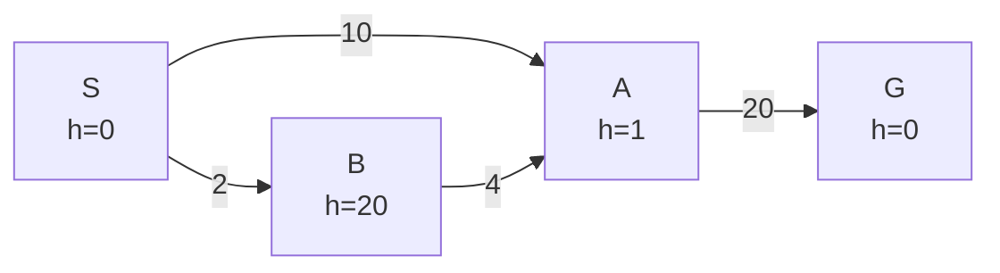

# AIMS5701 - Assignment1

NAME: **Wan Yiwei 万驿苇**
Student Number: **1155261963**

## Problem 1

### (a)

Three core information is required to describe a search state and a minimal sufficient search state is the tuple $s=(x,y,d,v)$, where:

- **Position** $x\in\{0,\ldots,M-1\}, y\in\{0,\ldots,N-1\}$ → determines where is the cart on the grid.
- **Direction** $d \in\{North,South,East,West\}$  → determines which direction is the cart heading.
- **Velocity** $v \in \{0,\dots,V_{max}\}$ → determines how far the cart moves.

Counting all combinations of these variables gives: $|\mathcal{S}_{\mathrm{repr}}|
= M \times N \times 4 \times (V_{\max}+1)$, which is the size of the state space.

Providing with the cart’s position, direction, and velocity are sufficient to **determine the next state for any legal action**.

### (b)

**No**.

There is a very crucial point that **movement action costs but it can cover several squares**. Therefore, the straight-line distance can overestimate the remaining action cost.

For example, consider an obstacle-free row of 10 squares. The cart starts at $(0,0)$, facing east with velocity 0, and the loading bay is at $(9,0)$. 

The following legal sequence brings the cart to the goal state in just six actions, so $h^*(s)\leq 6$. However, the straight-line distance heuristic gives $h(s)=9$. Thus, $h(s)>h^*(s)$, **violating the admissibility condition**. This counterexample shows that the heuristic is not guaranteed to be admissible for every valid instance.

| Action | New velocity | New position |
| ------ | ------------ | ------------ |
| fast   | 1            | $(1,0)$      |
| fast   | 2            | $(3,0)$      |
| fast   | 3            | $(6,0)$      |
| slow   | 2            | $(8,0)$      |
| slow   | 1            | $(9,0)$      |
| slow   | 0            | $(9,0)$      |

## Problem 2

### (a) 

| Step | Path  | Queue                        | Cost |
| ---- | ----- | ---------------------------- | ---- |
| 0    | S     | S→A, S→B, S→C                | 0    |
| 1    | S→A   | S→B, S→C, S→A→B, S→A→G       | 3    |
| 2    | S→B   | S→C, S→A→B, S→A→G, S→B→C     | 5    |
| 3    | S→C   | S→A→B, S→A→G, S→B→C, S→C→G   | 9    |
| 4    | S→A→B | S→A→G, S→B→C, S→C→G, S→A→B→C | 7    |
| 5    | S→A→G | S→B→C, S→C→G, S→A→B→C        | 13   |

### (b) 

| Step | Path      | Queue                      | Cost |
| ---- | --------- | -------------------------- | ---- |
| 0    | S         | S→A, S→B, S→C              | 0    |
| 1    | S→A       | S→A→B, S→A→G, S→B, S→C     | 3    |
| 2    | S→A→B     | S→A→B→C, S→A→G, S→B, S→C   | 7    |
| 3    | S→A→B→C   | S→A→B→C→G, S→A→G, S→B, S→C | 9    |
| 4    | S→A→B→C→G | S→A→G, S→B, S→C            | 12   |

### (c) 

| Step | Path    | Queue                            | Cost |
| ---- | ------- | -------------------------------- | ---- |
| 0    | S       | S→A, S→B, S→C                    | 0    |
| 1    | S→A     | S→B, S→A→B, S→C, S→A→G           | 3    |
| 2    | S→B     | S→A→B, S→B→C, S→C, S→A→G         | 5    |
| 3    | S→A→B   | S→B→C, S→C, S→A→B→C, S→A→G       | 7    |
| 4    | S→B→C   | S→C, S→A→B→C, S→B→C→G, S→A→G     | 7    |
| 5    | S→C     | S→A→B→C, S→B→C→G, S→C→G, S→A→G   | 9    |
| 6    | S→A→B→C | S→B→C→G, S→C→G, S→A→B→C→G, S→A→G | 9    |
| 7    | S→B→C→G | S→C→G, S→A→B→C→G, S→A→G          | 10   |

## Problem 3

### (a)

| Step | Path          | Priority Queue            | Cost |
| ---- | ------------- | ------------------------- | ---- |
| 0    | /             | (S, 9)               | 0    |
| 1    | S             | (B, 10), (A, 11), (C, 12) | 0    |
| 2    | S→B         | (C, 10), (A, 11), (C, 12) | 5    |
| 3    | S→B→C     | (G, 10), (A, 11), (C, 12) | 7    |
| 4    | S→B→C→G | (A, 11), (C, 12)          | 10   |

### (b)

Path: S→B→C→G; Cost: 10

## Problem 4

### (a)

**Yes**, because \(h(n)\leq h^*(n)\) for every node.

| Node | \(h(n)\) | \(h^*(n)\) |
| ---- | -------- | ---------- |
| S    | 9        | 10         |
| A    | 8        | 9          |
| B    | 5        | 5          |
| C    | 3        | 3          |
| G    | 0        | 0          |

### (b)

**Yes**, because \(h(u)\leq c(u,v)+h(v)\) for every edge.

| Edge               | \(h(u)\) | \(c(u,v)+h(v)\) |
| ------------------ | ---------------- | ---------------- |
| S→A | 9 | 3+8=11 |
| S→B | 9 | 5+5=10 |
| S→C | 9 | 9+3=12 |
| A→B | 8  | 4+5=9 |
| A→G | 8 | 10+0=10 |
| B→C | 5 | 2+3=5 |
| C→G | 3  | 3+0=3 |

## Problem 5

### (a)

A minimal sufficient search state is the tuple $s=(x,y,R)$, where:

- **Position** $x\in\{0,\ldots,M-1\}, y\in\{0,\ldots,N-1\}$ → determines where is the cart on the grid.
- **Remain** $R \subseteq \{1, \ldots, K\}$ → determines how many parcels have not been picked up.

Each package has two states: **taken or not taken**, and the goal condition is \(R=\varnothing\). So counting all combinations of these variables gives: $|\mathcal{S}_{\mathrm{repr}}|
= M \times N \times 2^{K}$, which is the size of the state space.

### (b)

#### (1)

**Yes** → A parcel at the robot’s current position has already been collected, so **every remaining parcel must be reached by a move**, which means collecting \(r(s)\) remaining parcels requires at least \(r(s)\) moves. Each move costs 2 units of energy, so \(h^*(s)\geq 2r(s)=h_1(s)\).

#### (2)

**Yes** → The goal state has no remaining parcels, so the robot must reach the parcel farthest from its current position. Reaching that parcel requires at least \(D(s)\) moves and therefore at least \(2D(s)\) units of energy. If the parcels are along the way, collecting them requires no additional energy. However, if a parcel lies on no shortest path to the farthest parcel, collecting it requires additional travel and more energy. Thus, \(h^*(s)\geq 2D(s)=h_2(s)\).

## Problem 6

### (a)

| Difference   | Tree search                                                  | Graph search                                                 |
| ------------ | ------------------------------------------------------------ | ------------------------------------------------------------ |
| Same State   | Treats different paths to the same state as separate search nodes. | Records states and handles repeated states according to the algorithm. |
| Facing Cycle | May repeatedly generate states along a cycle.                | Detects repeated states and reduces redundant expansion.     |
| Effect       | Easy, less memory but time-consuming.                        | Complex, more memory but efficient.                          |

Therefore, graph search aims to avoid repeatedly exploring the same states, especially in graphs with cycles.

### (b)

#### (1)

The heuristic is admissible but inconsistent under the following conditions:

- \(h(S)=0\leq h^*(S)=26\)
- \(h(A)=1\leq h^*(A)=20\)
- \(h(B)=20\leq h^*(B)=24\)
- \(h(G)=0=h^*(G)\)
- \(h(B)=20>cost(B, A)+h(A)= 4+1 = 5\)

When B is expanded, it reveals a cheaper path to A with \(g(A)=2+4=6\). But A is already closed, this path is ignored. A* therefore returns S → A → G, costing 30, although S → B → A → G costs only 26.

| Step | Removed | Frontier                    | Closed set |
| ---- | ------- | --------------------------- | ---------- |
| 0    | /       | S \((0,0)\)                 | ∅          |
| 1    | S       | A \((10,11)\), B \((2,22)\) | {S}        |
| 2    | A       | B \((2,22)\), G \((30,30)\) | {S, A}     |
| 3    | B       | G \((30,30)\)               | {S, A, B}  |
| 4    | G       | ∅                           | {S, A, B}  |

#### (2)

**Modification:** If a cheaper path to a state in the closed set is found, update its path cost and parent, remove it from the closed set, and put it back in the frontier for re-expansion.

