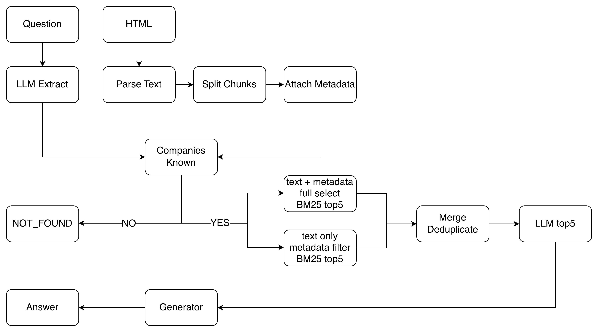
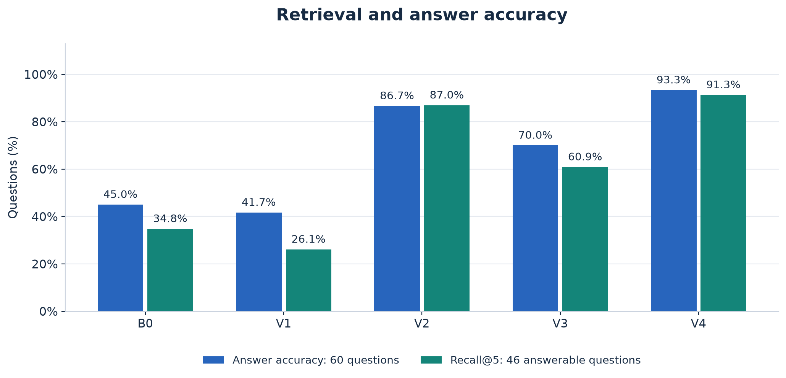
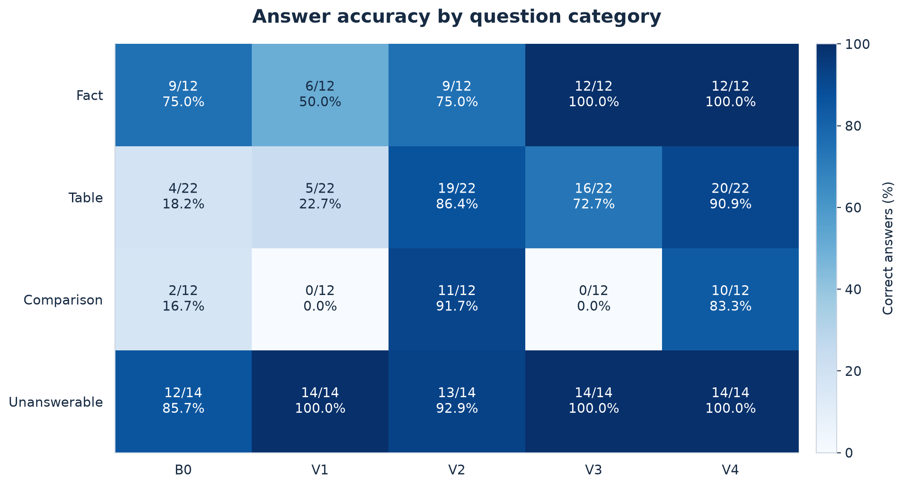
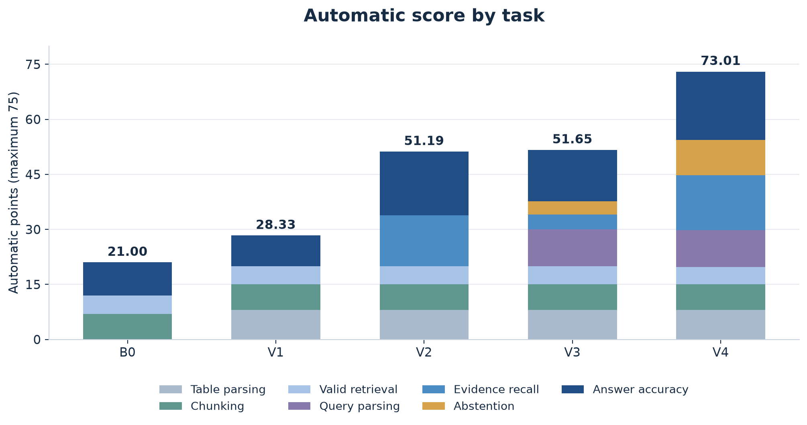
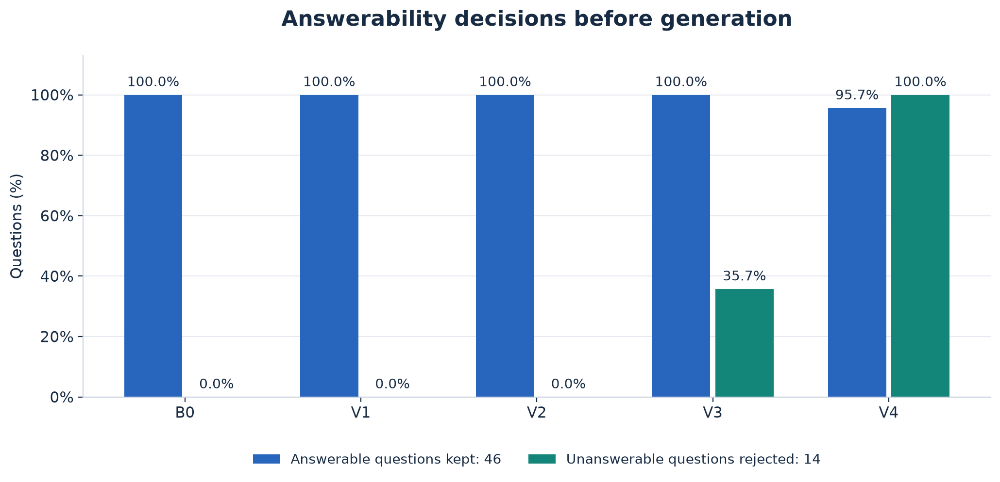

# Homework 4 solution

## Execution Pipeline

1. **HTML parsing:** Use BeautifulSoup to parse HTML and convert each table row into text that preserves its row label, column labels and original values.
2. **Document chunking:** Split each section or table into chunks of at most 1,500 characters with a 100-character overlap.
3. **Metadata extraction:** Extract `source`, `company`, `fiscal_year` and `doc_type` for each chunk.
4. **BM25 indexing:** Build index A from chunk text and metadata, and index B from chunk text alone.
5. **Query parsing:** Use an LLM to identify the companies, year and document type requested in the question.
6. **Company validation:** Return an empty list if the question mentions a company absent from the corpus.
7. **Parallel retrieval:** Retrieve the top five chunks through A across the whole corpus and through B after filtering by company and document type.
8. **Candidate merging:** Merge the candidates from both routes and remove duplicate chunks.
9. **Evidence selection:** Use an LLM to check the company, year and metric in each candidate and select up to five supporting chunks, returning an empty list if the evidence is insufficient.
10. **Answer generation:** Use the provided generator to produce a number, name or `NOT_FOUND` from the selected evidence.

## Ablation Setup

- **Run the ablation:** Run `python comparison.py <variant>` with `B0`, `V1`, `V2`, `V3` or `V4` to generate the corresponding `results_<variant>.csv` file.

- **Final implementation:** V4 directly reuses [hw4.py](hw4.py), and [results.csv](results.csv) is identical to `results_V4.csv`.

| Group | Tokenisation | Scoring | Retrieval |
| --- | --- | --- | --- |
| B0 | raw text recursive splitting Lowercase whitespace tokens | Body Only | Full-corpus |
| V1 | Structured table text section splitting Lowercase regex tokens | Body Only | Full-corpus |
| V2 | Same as V1 | Body + Metadata | Full-corpus |
| V3 | Same as V1 | Body Only | Metadata Filtering |
| V4 | Same as V1 | Body + Metadata for A Body Only for B | LLM selection |

## Results Analysis

### General Performance Comparison

| Group                | Recall@5 | Answer accuracy | Answerable kept | Unanswerable rejected | Automatic points |
| -------------------- | -------: | --------------: | --------------: | --------------------: | ---------------: |
| [B0](results_B0.csv) |    34.8% |   45.0% (27/60) |          100.0% |                  0.0% |            21.00 |
| [V1](results_V1.csv) |    26.1% |   41.7% (25/60) |          100.0% |                  0.0% |            28.33 |
| [V2](results_V2.csv) |    87.0% |   86.7% (52/60) |          100.0% |                  0.0% |            51.19 |
| [V3](results_V3.csv) |    60.9% |   70.0% (42/60) |          100.0% |                 35.7% |            51.65 |
| [V4](results_V4.csv) |    91.3% |   93.3% (56/60) |           95.7% |                100.0% |            73.01 |

### Answers

**V1 vs. B0.**

V1 preserves table labels and section boundaries, improving evidence readability. However, retrieval still relies on basic BM25, and the changed chunk structure affects keyword rankings. This explains why better preprocessing does not immediately improve answer accuracy.

**V2 vs. V1.**

V2 adds company, year, and document-type metadata to BM25 indexing, making relevant documents easier to retrieve. Better evidence coverage directly improves answer accuracy, especially for table and comparison questions.

**V3 vs. V1 and V2.**

V3 introduces LLM query parsing and metadata filtering, reducing irrelevant documents. All required evidence remains available after filtering, but body-only BM25 does not always rank it in the top five. For comparison questions, ranking candidates together also fails to guarantee evidence for every company, explaining the regression from V2.

**V4.**

V4 combines global and metadata-filtered retrieval, then uses an LLM to select sufficient evidence. This improves evidence coverage and removes irrelevant passages, making answers more accurate and consistent across question categories.

### Scores

**V1 vs. B0.**

The score increase comes from structured table parsing, which earns 8 additional points. Chunking remains at 7 points in both versions, while lower answer accuracy slightly offsets the gain.

**V2 vs. V1.**

Metadata-enhanced retrieval increases evidence recall, earning more retrieval points and improving downstream answer accuracy. The recall improvement is especially valuable because its scoring function rewards performance above a fixed threshold.

**V3 vs. V1 and V2.**

Query parsing and partial abstention introduce new scoring gains. However, lower retrieval recall and answer accuracy offset these improvements, leaving the total score only slightly above V2.

**V4.**

Combining retrieval strategies restores evidence recall, while LLM-based selection improves answer accuracy and abstention. These improvements contribute to multiple scoring components, producing the highest overall score.

### Abstention

**V1 vs. B0.**

Neither version checks answerability before generation. Both return BM25 passages even when relevant evidence is missing, so neither can reject unanswerable questions at the retrieval stage.

**V2 vs. V1.**

Metadata enrichment improves passage ranking but does not change the decision to always return retrieved chunks. Therefore, better retrieval alone provides no explicit abstention capability.

**V3 vs. V1 and V2.**

V3 checks whether the requested companies exist in the corpus and rejects questions involving unknown companies. However, company existence does not guarantee that the requested facts are available, limiting its rejection capability.

**V4.**

V4 uses an LLM to verify whether the retrieved passages provide sufficient evidence to answer each question. When the evidence is insufficient, it returns an empty retrieval result, preventing unsupported answers. This significantly improves abstention accuracy. However, the stricter verification may occasionally reject answerable questions when relevant evidence is incomplete or incorrectly judged insufficient, resulting in a slight decrease in answerable-question retention.

## Error Analysis

The final `hw4.py` implementation makes four errors in [results_V4.csv](results_V4.csv), all returning `NOT_FOUND` despite the answers being present in the corpus.

The errors likely start with BM25 ranking: passages sharing the company name and year can score highly even when they lack the requested financial row. Each route keeps only five chunks, and neither guarantees that every company in a comparison contributes the required value. Overlap between A and B can further reduce candidate diversity. The LLM then receives incomplete evidence and may either pass partial evidence to the generator or return an empty list. This makes candidate ranking and evidence coverage the main weaknesses behind these failures.

| Question | Expected answer | Retrieval result |
| --- | --- | --- |
| q013 | Brightwater Energy | Partial comparison evidence |
| q022 | Orchid Bay Hotels | Partial comparison evidence |
| q040 | 162.6 | Empty result |
| q054 | 297.4 | Empty result |