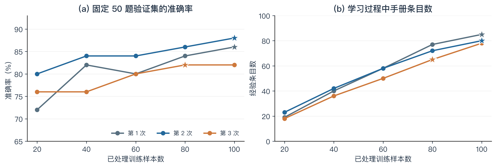
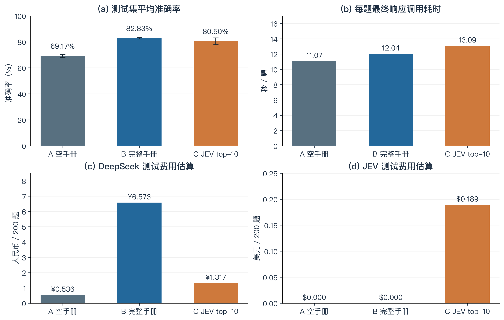

# Report：ACE 在 Formula 金融推理任务上的复现与优化

## 1. 项目介绍

### 1.1 项目原理

本项目旨在复现 Agentic Context Engineering（[ACE](https://github.com/ace-agent/ace)）在 Formula 金融数值推理任务上的离线上下文学习流程，并复现其设计目标：校验在不更新语言模型权重的条件下，通过将训练过程中积累的经验加入提示词，能否提高金融计算题的回答准确率。

ACE 本质上并不是智能体或者 Harness 平台，而是一个围绕语言模型组织生成、反思和经验整理的框架。它将可重复使用的公式、解题策略和常见错误保存为文本手册，并在后续任务中作为上下文的一部分提供给模型。因此，本文所称的“训练”是生成和更新手册，不涉及梯度计算、参数微调或训练新的神经网络。而 Formula 金融数值推理任务其实是要求模型在不提供任何计算公式和金融领域知识的前提下，理解金融概念、识别数值、选择计算方法并输出结果（例如，给出流动资产和流动负债，要求计算流动比率）。

ACE 的工作原理如图 1 所示：

1. Generator 首先读取题目与当前手册，生成推理过程和答案。
2. 程序将答案与训练集标准答案比较，再把回答及正确性反馈交给 Reflector。
3. Reflector 分析错误原因或总结有效策略。
4. 对于错题，Generator 可以参考反思重新作答。
5. Curator 将这些经验整理为结构化条目，由程序增量写入手册。
6. 新的手册用于 Generator 解答下一道训练题，形成“作答—反馈—反思—积累经验”的多步循环。


### 1.2 智能体定义

本实验中的三个角色由同一个模型通过不同提示词实现，提示词要求以 JSON 格式返回各自的处理结果。

**Generator（解题者）**：提供题目、手册及反思内容。

- `reasoning`：说明所采用的解题方法、计算过程和判断依据。
- `bullet_ids`：列出模型认为与当前解题相关的手册条目编号。
- `final_answer`：给出最终答案，由程序提取后与标准答案比较。

**Reflector（反思者）**：提供题目、解答思路、预测答案、标准答案、正确性反馈，被引用的经验条目。

- `reasoning`：给出对当前作答过程的分析。
- `error_identification`：指出具体的概念、计算或策略使用错误。
- `root_cause_analysis`：解释错误背后的原因，而不只描述错误结果。
- `correct_approach`：说明应采用的正确解题方法，供 Generator 重答时参考。
- `key_insight`：总结值得保留的公式、策略或注意事项，供 Curator 整理。
- `bullet_tags`：为相关条目标记 `helpful`、`harmful` 或 `neutral`，每个元素包含 `id` 和 `tag`，由程序更新条目的使用反馈计数。

**Curator（整理者）**：提供当前手册、最新反思、训练进度、手册统计和 Token 预算。

- `reasoning`：解释为何需要补充这些经验。
- `operations`：返回增量操作列表，每项包含操作类型 `type`、所属章节 `section` 和经验正文 `content`。

## 2. 实验设置

### 2.1 环境与模型

- Python：`3.12.14`
- OpenAI Python SDK：`2.21.0`
- Hardware：`Macbook Air 2`
- Operator System：`MacOS 14.6`
- LLM：`siliconflow/deepseek-v3.1-terminus`（阿里云百炼北京地域调用硅基流动）
- Response：`temperature=0`、`enable_thinking=false`、`max_token=4096`

### 2.2 实验数据

实验采用仓库 `eval/data/` 下的 Formula 数据，原文件包含 500 道训练题、300 道验证题和 200 道测试题，三个划分覆盖相同的 50 种公式。每条记录包含题目内容与数值标准答案，原始题目内容还包含公式名称、公式表达式和变量说明。

为控制费用，本项目按公式类别分层抽样，从每种公式中选取两道训练题和一道验证题，形成 100/50/200 的训练、验证、测试规模，测试集全部保留。训练和验证抽样分别使用种子 42 和 43，抽样后按源文件行号排序。各组三次实验使用相同的样本与顺序，重复运行时不重新抽样，配置及样本 ID 保存在 `results/plan.json` 中。

模型实际接收的输入经过统一预处理：移除题干前的独立公式说明，保留题干，并补充输出浮点数、必要时保留两位小数和进行单位换算的要求。因此，本实验的“无公式”特指不直接提供原始数据中的公式说明，题干仍可能出现公式名称，B/C 的经验手册也可以包含学习得到的公式。

训练集用于 B 的反思与手册更新，验证集只用于选择最佳手册，测试集用于比较三组的最终表现。验证和测试时，标准答案均不作为生成输入；尤其在 C 中，JEV 只能看到题目和候选经验，不能读取测试标签。

### 2.3 训练过程（以 B 为例）

B 的每次实验均从空手册开始，以批大小一顺序处理 100 道训练题，共运行一个 epoch。具体流程如下：

1. **首次作答**：Generator 读取当前训练题和已有手册，在没有反思提示的情况下生成答案，程序据此判断正误。
2. **反思与纠错**：若答错，Reflector 根据训练标准答案诊断问题，Generator 参考反思重新作答；最多进行三轮，答对则提前停止。若首次答对，仍调用一次 Reflector 总结经验并评价引用条目。
3. **更新手册**：每处理一道题，Curator 都结合最新反思与当前手册提出新增经验，程序执行有效的 `ADD` 操作；若没有新内容，则不添加条目。
4. **记录更新后表现**：Generator 使用更新后的手册、在反思为空的情况下再次回答当前训练题，记录更新前后的答案、正误和实际反思轮数，再进入下一题。
5. **定期验证**：在第 20、40、60、80、100 步，使用当时的完整手册回答固定的 50 道验证题；验证时不反思或更新手册，只计算准确率。
6. **保存最佳手册**：若当前验证准确率严格高于此前最佳值，就保存该检查点的手册；同分时保留较早的版本，并继续完成剩余训练。
7. **固定手册测试**：完成 100 道训练题后，使用最佳手册回答全部 200 道测试题，每题保留一个最终响应，测试期间不再学习；该手册同时供同编号的 C 实验复用。

这里的“三轮”是单道错题的反思与重答上限，不是三个 epoch，也不表示测试时对每题生成三个候选答案。当前试验的学习记录与最佳手册分别保存在对应 B 目录中的 `train_results.json` 和 `best_playbook.txt`。

### 2.4 对照设计

本实验设置 A、B、C 三组，通过两个对照关系分别检验“是否使用经验手册”与“是否筛选手册内容”的影响。

| 组别 | 名称 | 测试时提供的经验 | 学习过程 | 设计目标 |
|---|---|---|---|---|
| A | none | 无经验条目 | 不学习，直接回答测试题 | 测量统一提示词下模型自身的能力 |
| B | playbook | 验证集选出的完整手册 | 从空手册开始学习，错题最多三轮反思与重答 | 检验经验积累相对 A 的收益 |
| C | jev | 同编号 B 手册中按题目筛选的十条经验 | 复用 B 的最佳手册，不重新学习 | 检验读取筛选相对 B 的准确率与开销变化 |

A/B 对照保持题目预处理、Generator 提示词、基础模型和解码参数一致，只改变是否提供学习得到的经验手册。因此，A 是本实验内部的空手册基线，用于隔离手册带来的作用，不直接等同于论文采用默认提示词的 Base LLM。

B/C 对照进一步固定手册来源：C/01、C/02、C/03 分别读取 B/01、B/02、B/03 的最佳手册，只在每次回答前增加 JEV Score top-10 筛选。C 不重新训练、不修改保存的手册，也不通过验证集调整 k；得分相同时按手册原顺序选择，选中的条目仍按原顺序呈现给 Generator。

三组均在同一批 200 道测试题上重复运行三次。每次 B 独立从空手册学习，C 与同编号 B 配对；测试时不反思、不投票，也不根据标准答案从多次回答中择优。这样的设计使 A/B 衡量经验积累的整体收益，B/C 衡量固定 top-10 读取策略的增量效果。
### 2.5 结果指标

设一次测试包含 \(N=200\) 道题，\(\hat y_i\) 为第 \(i\) 题的预测答案，\(y_i\) 为标准答案，\(T_{in}\) 和 \(T_{out}\) 分别为对应服务在测试阶段累计报告的输入与输出 Token。

| 指标 | 定义 | 公式 |
|---|---|---|
| 准确率 | 全部测试题中，预测数值与标准答案一致的比例 | \(a=\frac{1}{N}\sum_{i=1}^{N}\mathbf{1}(\hat y_i=y_i)\) |
| 响应时间 | 每题最终保存响应所属调用的平均耗时，C 另计该题的 JEV 评分耗时 | \(\bar t=\frac{1}{N}\sum_{i=1}^{N}(t_{DS,i}+t_{JEV,i})\) |
| Token 成本 | 根据各服务累计 Token 与指定单价估算的测试费用，输入与输出暂按同价计费 | \(C_{DS}=0.004(T_{in}+T_{out})/10^3\) 元；\(C_{JEV}=0.042(T_{in}+T_{out})/10^6\) 美元 |

准确率采用数值 Exact Match：移除答案中的逗号后转换为浮点数并严格比较，不额外设置误差容限；无法提取答案或未成功完成的题目仍计入分母并判错。对每组三次实验的准确率 \(a_1,a_2,a_3\)，同时报告均值和样本方差：

\[
\bar a=\frac{1}{3}\sum_{r=1}^{3}a_r,\qquad
s^2=\frac{1}{2}\sum_{r=1}^{3}(a_r-\bar a)^2.
\]

样本方差按 0–1 范围的准确率计算，标准差为 \(\sqrt{s^2}\)；换算为百分点时再乘以 100。三次使用相同数据，因此这些统计量描述重复运行的波动，而不是不同数据划分上的泛化误差。

时间公式中的 \(t_{DS,i}\) 取自最终响应日志的 `total_time`，包含该次调用内部的重试；\(t_{JEV,i}\) 为该题 JEV 各批请求的累计耗时，A/B 中为零。该口径排除更早已耗尽的独立调用、中断等待和本地处理，不能视为完整测试墙钟时间。另行报告的 `wall_seconds` 反映完整运行时间，其中 B 还包含训练和验证，因此不能直接作为三组测试速度的对照。

费用使用 `result.json` 中测试阶段的累计用量，与时间采用的最终响应视图不同；已报告的额外调用 Token 也计入费用。结果中的测试成本以每次 200 题为单位，再对三次取均值。DeepSeek 按人民币计价，JEV 按美元计价，两者分列；这些是按指定单价计算的估算值，未包含未返回用量的请求，也未套用缓存优惠。B 的训练与验证费用单独统计，C 复用这份学习投入，汇总配对实验时只计一次。

## 3. 复现结果

### 3.1 A/B/论文 对比

复现目标对应 ACE 论文金融任务结果中“有训练标签的离线 ACE 改善 Formula 准确率”这一结论。论文表 2 的 Base LLM 准确率为 67.5%，有标签的离线 ACE 为 85.5%，提高 18.0 个百分点。论文使用 DeepSeek-V3.1，并将反思轮数和离线 epoch 数的上限设为五。

B 相比 A 在三次实验中分别提高 14.0、15.0 和 12.0 个百分点，平均提高 13.67 个百分点。B 的均值比论文离线 ACE 低 2.67 个百分点，但三次均明显优于本地空手册基线。这支持了经验手册对当前任务具有收益的复现目标，而不是证明本实验精确复现了论文数值。

这一差异不能简单归因于某一个因素。本实验使用 Terminus 更新版和不同的服务入口，训练及验证样本缩减为 100 和 50，学习预算也缩减为一个 epoch、最多三轮反思。此外，论文 Base LLM 使用数据集默认提示词，而 A 使用去掉独立公式说明后的题目和 ACE Generator 提示词，因此 A 是为本地受控比较设计的空手册基线，不能直接等同于论文的 Base LLM。当前学习实现也未启用语义去重。模型、预算和输入协议均有差异，本文只将论文数值作为参照，以 A/B 的同条件比较判断手册收益。

| 方法 | 平均准确率 |
|---|---:|
| 本实验-Base LLM | 69.17% |
| 论文-Base LLM | 67.50% |
| 本实验-离线 ACE | 82.83% |
| 论文-离线 ACE | 85.50% |

### 3.2 验证过程

三次实验在第 20 步的验证准确率分别为 72%、80% 和 76%，最佳验证准确率分别为 86%、88% 和 82%。整体上，随着经验积累，验证表现提高，但并非单调上升：B/01 从第 40 步的 82% 下降至第 60 步的 80%，之后才再次提升。因此，不能假定最后生成的手册一定最好，也不能把手册条目数增加直接等同于能力提高。

B/01 和 B/02 均选择第 100 步，最佳手册分别含 85 条和 80 条经验。B/03 在第 80 步达到 82%，第 100 步仍为 82%，按同分保留较早检查点的规则选择第 80 步的 65 条手册，而不是训练结束时的 78 条手册。这些固定检查点分别用于 B 的测试和对应 C 的筛选，避免依据测试成绩再挑选手册。



## 4. 我的改造

### 4.1 基于 JEV Score 的读取筛选

原本的 B 在每道测试题中都传入完整手册。由于当前 Curator 的主要操作是添加经验，手册会随训练逐渐增长，其中既有当前题目可以使用的公式，也有其他金融概念、一般性提醒和可能重复的条目。本次改造只改变手册的读取方式：在 Generator 回答前，使用 JEV 判断当前问题与已有经验的相关性，只保留得分最高的十条。其假设是减少无关上下文可以降低输入开销，并可能降低干扰；是否改善准确率则由实验检验。

JEV 的输入由当前题目和一批候选经验的编号、正文及章节组成，不包含测试标准答案。每条经验使用相同的固定指令，要求仅判断相关性和可用性，不解答题目、不验证算术。评分采用四个等级锚点：

| 等级 | 含义 |
|---:|---|
| 0 | 与当前题目无关 |
| 1 | 仅话题相关，或只是泛泛提醒 |
| 2 | 可用于辅助步骤 |
| 3 | 直接支持核心公式或关键计算步骤 |

[TypeSafe Score](https://docs.typesafe.ai/primitives/score) 返回的分数可以位于两个等级之间，因此代码直接使用 0–3 范围内的原始数值排序，不将其取整。`confidence` 和 `probabilities` 用于审计，前者不影响排序，后者不用于重新计算 score。当前实现保留条目完整性、类型及分数范围检查，不以概率之和是否等于一作为中断条件。

核心选择逻辑位于 [jev.py](ace/src/experiments/jev.py)：

```python
ranked = sorted(
    bullets,
    key=lambda bullet: (-scores[bullet["id"]], bullet["line_index"]),
)
selected = ranked[:self.k]
```

这段逻辑按 score 降序选取十条，同分保持原手册顺序。选中后，程序按照原手册中的顺序重建文本，保留章节结构，再交给 DeepSeek 回答；不是将经验永久删除或改写，也不是让 JEV 代替 DeepSeek 解题。若手册不超过十条，则直接全部使用。此次三份最佳手册分别有 85、80 和 65 条，均需要评分，每题分别产生五、四和四个 JEV 请求。

C 没有独立的训练或验证过程，其学习曲线就是图 2 中对应 B 手册的来源曲线。改造发生在测试读取阶段，因此不能绘制一条新的“C 训练准确率曲线”，也不能将测试标签用于调整筛选规则。B/C 的配对比较仅改变是否进行 JEV top-10 筛选，其余题目、模型、生成提示词和手册来源保持一致。

### 4.2 改造效果

| 配对实验 | B 准确率 | C 准确率 | C−B | B 错、C 对的题数 | B 对、C 错的题数 |
|---|---:|---:|---:|---:|---:|
| 01 | 82.50% | 77.50% | −5.00 个百分点 | 10 | 20 |
| 02 | 83.50% | 82.50% | −1.00 个百分点 | 6 | 8 |
| 03 | 82.50% | 81.50% | −1.00 个百分点 | 5 | 7 |
| 平均 | 82.83% | 80.50% | −2.33 个百分点 | 7.00 | 11.67 |

C 的平均准确率为 80.50%，仍比 A 高 11.33 个百分点，但低于完整手册 B。其样本方差为 0.0007000，对应标准差 2.65 个百分点，也高于 B 的 0.58 个百分点。按重复编号和样本 ID 配对后，三次共有 21 个“B 错、C 对”的观测和 35 个“B 对、C 错”的观测，净减少十四个正确回答。这些是同一批题目的重复观测，不能视为 600 道相互独立的新题。现有结果不支持固定 top-10 提高准确率的假设，也不足以进行广泛的统计显著性或泛化声明。

一个具体例子来自第一次实验的 `test:000014`（[预测记录](ace/results/C/01/predictions.jsonl)、[筛选审计](ace/results/C/01/jev_audit.jsonl)），题目给出净利润 50,000、股东权益 200,000，要求计算股本回报率（ROE），标准答案为 25.0。B 输出 25.0，而 C 输出 0.25，差异在于百分数与小数的表达规范。JEV 审计显示，包含正确 ROE 计算规则的 `calc-00077` 得分为 2.91，实际上已经入选；同时入选的其他条目对“是否乘以 100”存在不同指引，且一条 Black–Scholes 相关经验也以 2.77 分被选入。因此，这个错误不能解释为“筛选一定漏掉了正确公式”，而是说明相关性评分不能保证所选经验彼此一致，也不能保证回答模型正确应用它们。

这一案例提供了理解结果的线索，但不能代表全部退化题目。固定数量筛选可能遗漏辅助约束，也可能保留相互冲突的高分条目；这些都是待进一步验证的机制。本次没有设置随机 top-10、关键词检索或不同 k 的额外对照，因此不能区分收益或损失究竟来自上下文缩短、JEV 排序质量，还是二者共同作用。

## 5. 最终结论

### 5.1 准确率、时间与成本的综合比较



| 组别 | 平均准确率 | 每题最终响应调用耗时 | DeepSeek 测试 Token | JEV 测试 Token | DeepSeek 估算费用 | JEV 估算费用 |
|---|---:|---:|---:|---:|---:|---:|
| A | 69.17% | 11.07 秒 | 133,918 | 0 | ¥0.536 | $0 |
| B | 82.83% | 12.04 秒 | 1,643,291 | 0 | ¥6.573 | $0 |
| C | 80.50% | 13.09 秒 | 329,276 | 4,506,510 | ¥1.317 | $0.189 |

相比 B，C 的 DeepSeek 测试总 Token 减少 79.96%，其中输入 Token 减少 82.52%。但被筛掉的经验仍需要先送给 JEV 评分，C 每次平均增加约 451 万个 JEV Token，因此不能据此声称“所有服务合计 Token 减少”。采用给定单价后，DeepSeek 部分的平均费用从 ¥6.573 降至 ¥1.317，另产生 $0.189 的筛选费用；在未指定汇率前，本文不将其合并成单一总价。C 的最终响应调用耗时从 B 的 12.04 秒增加到 13.09 秒，约增加 8.71%，所以这次改造也没有表现为单题调用加速。

测试费用之外，B 每次学习及验证平均消耗 3,386,263 个 DeepSeek Token，约 ¥13.545。这是获得手册的前置投入，C 复用同一份投入，无需重新训练。若从空手册开始使用 B，学习加一次 200 题测试的平均 DeepSeek 费用约为 ¥20.118；若从空手册获得手册后直接采用 C，平均为 ¥14.862 加 $0.189。将 B 和 C 作为同一个配对实验统计时，学习投入只能计一次，不能分别给两组重复计费。

| 组别 | 第一次完整运行时间 | 第二次完整运行时间 | 第三次完整运行时间 | 平均 |
|---|---:|---:|---:|---:|
| A | 8.79 分钟 | 15.48 分钟 | 11.25 分钟 | 11.84 分钟 |
| B | 164.15 分钟 | 135.44 分钟 | 130.49 分钟 | 143.36 分钟 |
| C | 20.95 分钟 | 11.53 分钟 | 9.58 分钟 | 14.02 分钟 |

这张表保留 `result.json.wall_seconds` 的完整运行记录。B 包含学习、五次验证及测试，C 仅包含筛选与测试；部分已有记录还包含中断恢复相关等待，A 的记录保留累计执行时间。这些数值反映实际完成实验的时间投入，不能将 B 的 143.36 分钟直接与 C 的 14.02 分钟比较，并得出筛选使测试加速十倍的结论。测试和验证使用四个并发工作线程，完整运行墙钟时间也不等于逐题调用耗时之和。

### 5.2 复现中的问题与结论边界

复现中的主要工程问题是模型服务接入、输出格式和外部评分接口的稳定性。为使用可获得的服务，本项目将模型调用统一适配到百炼的 OpenAI 兼容接口，固定模型标识、关闭专用思考模式，并通过本地环境变量提供密钥。对网络超时设置有限重试，对 JSON 之外的常见最终答案格式进行解析，但不因为解析失败而缩小测试分母。JEV 曾因返回概率之和不等于一触发校验失败；最终实现改为直接使用返回的 score 排序，概率原样记录，同时保留完整性和范围检查。这些调整解决了执行和记录问题，不改变数值答案的正确性标准。

本次复现表明，在固定模型和测试集下，ACE 的经验积累流程能够提高 Formula 的解题准确率：B 相比 A 的平均提升为 13.67 个百分点，验证曲线也显示手册学习具有可观察的收益。由于模型版本、训练规模、反思预算和基线提示词与论文存在差异，可以确认的是该行为在小规模设置中得到了复现，而不是论文全部结果或精确数值被重现。

JEV top-10 的结果体现了准确率与输入开销之间的权衡。它显著减少了交给 DeepSeek 的内容，但平均损失 2.33 个百分点的准确率，并增加了筛选调用开销。在当前设置下，若优先考虑准确率，完整手册 B 更合适；若重点是限制 DeepSeek 上下文用量，C 提供了可量化的压缩方案，但应同时核算 JEV 费用并接受已经观察到的精度损失。后续可以针对经验间冲突或关键计算规则的保留方式进一步设计对照；这些尚未执行的改进不属于本报告的实验结论。

本文图表依据当前保存的 [配置](ace/config.json)、[汇总](ace/results/summary.csv)、各次 `result.json`、`predictions.jsonl`、调用日志和 B 的训练记录生成；实现细节以 [实验编排](ace/src/experiments/runner.py)、[数值评分](ace/eval/data_processor.py) 和 [JEV 筛选](ace/src/experiments/jev.py) 为准，补充说明见 [formula_experiments.txt](assets/formula_experiments.txt)。
