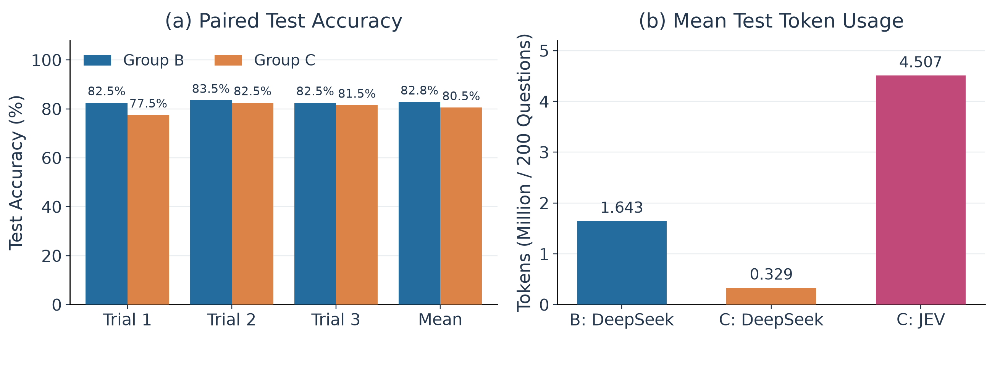
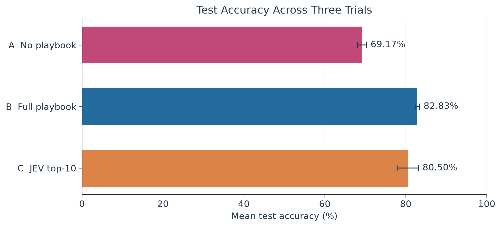

# Report: Reproducing and Improving ACE on the Formula Financial Reasoning Task

## 1. Project Introduction

### 1.1 Project Principles

This project reproduces the offline context-learning process of Agentic Context Engineering on the Formula financial numerical reasoning task. It examines whether adding experience accumulated during training to the prompt can improve accuracy on financial calculation questions without updating the language model's weights.

ACE is a framework that organizes generation, reflection, and experience curation around a language model, rather than an agent or a harness platform. It stores reusable formulas, problem-solving strategies, and common errors in a text playbook, which is then provided to the model as part of its context for subsequent tasks. Accordingly, “training” in this report refers to generating and updating the playbook; it does not involve gradient computation, parameter fine-tuning, or training a new neural network. The Formula financial numerical reasoning task requires the model to understand financial concepts, identify numerical values, select calculation methods, and produce results. In this experiment, the formulas and explanations in the original data are not directly provided to the model, although it may obtain relevant information from the playbook.

As shown in the figure, ACE follows a multistep cycle of question answering, feedback and reflection, and experience accumulation.

1. The Generator answers the current training question using the existing playbook. If its answer is incorrect, it can retry up to three times with additional reflection prompts.
2. The Reflector reflects on the answer using the ground truth and the result of the response, producing corrective suggestions and reusable experience.
3. The Curator combines the reflection with the existing playbook to produce new entries that are ultimately added to the playbook.


### 1.2 Agent Roles

The three roles in this experiment are implemented by the same model using different prompts, and each is instructed to return its result in JSON format.

**Generator**

- `reasoning`: Describes the solution method, calculation process, and reasoning behind the answer.
- `bullet_ids`: Lists the identifiers of playbook entries the model considers relevant to the current question.
- `final_answer`: Provides the final answer, which the program extracts and compares with the ground truth.

**Reflector**

- `reasoning`: Analyzes the current response.
- `error_identification`: Identifies specific errors in concepts, calculations, or the use of strategies.
- `root_cause_analysis`: Explains the underlying causes of errors rather than merely describing the outcome.
- `correct_approach`: Describes the correct solution method for the Generator to consult when answering again.
- `key_insight`: Summarizes formulas, strategies, or cautions worth retaining for the Curator to organize.
- `bullet_tags`: Labels relevant entries as `helpful`, `harmful`, or `neutral`. Each element contains an `id` and a `tag`, which the program uses to update the entries' feedback counts.

**Curator**

- `reasoning`: Explains why the experience should be added.
- `operations`: Returns a list of incremental operations, each containing the operation type `type`, the relevant section `section`, and the experience text `content`.

## 2. Experimental Setup

### 2.1 Experimental Environment

- Python: `3.12.14`
- OpenAI Python SDK: `2.21.0`
- Hardware: `Macbook Air M2`
- Model: `siliconflow/deepseek-v3.1-terminus`
- Response: `temperature=0`, `enable_thinking=false`, `max_tokens=4096`

### 2.2 Experimental Data

The experiment uses the Formula data in the repository's `eval/data/` directory. The original files contain 500 training questions, 300 validation questions, and 200 test questions, covering the same 50 formulas. Each record contains the question and its numerical ground-truth answer. The training set is used for reflecting on results and updating the playbook, the validation set for selecting the best playbook, and the test set for measuring final performance. Stratified sampling by formula category is used, with seeds 42 and 43 for the training and validation sets, respectively. Two training questions and one validation question are selected per formula, yielding 100 training, 50 validation, and 200 test questions; the entire test set is retained. The sampled questions are sorted by their line numbers in the source files, and all three trials in each group use the same samples in the same order.

### 2.3 Experimental Procedure

Using Group B as an example, each trial starts with an empty playbook. Results are saved in `ace/results/B/01/`, `02/`, and `03/`, respectively:

1. **Training**: The 100 training questions are processed individually in a fixed order, with a batch size of 1 and one training epoch. Each incorrectly answered question undergoes up to three rounds of reflection and re-answering. After each question, the playbook is curated and updated as needed. Per-question answers, correctness, and numbers of reflection rounds are saved in each trial's `train_results.json`, while model call records are saved in `llm_calls.jsonl`.
2. **Validation**: At steps 20, 40, 60, 80, and 100, the current full playbook is used to answer the same 50 validation questions. Validation records are saved in `train_results.json`, and the playbook with the highest validation accuracy is saved as `best_playbook.txt`. In the event of a tie, the earlier playbook is retained.
3. **Testing**: After all 100 training questions have been processed, the best playbook is used to answer all 200 test questions. Per-question predictions and correctness are saved in `predictions.jsonl`; test accuracy, elapsed time, usage, and other summary information are saved in `result.json`.

### 2.4 Experimental Groups

| Group | Type | Experience | Learning Process | Objective |
|---|---|---|---|---|
| A | no playbook | No experience entries | Answers test questions directly, without learning | Measure the model's baseline ability under the common prompt |
| B | full playbook | Full playbook selected using the validation set | Learns from an empty playbook, with up to three rounds of reflection and re-answering for incorrect answers | Examine the benefit of accumulated experience relative to A |
| C | partial playbook | Reuses B's playbook, selecting only the 10 highest-scoring entries | Reuses B's best playbook without learning again | Examine the benefit of selected experience relative to B |

### 2.5 Evaluation Metrics

| Metric | Definition | Formula |
|---|---|---|
| Accuracy | Proportion of predictions whose numerical values match the ground truth | \(a=\frac{1}{N}\sum_{i=1}^{N}\mathbf{1}(\hat y_i=y_i)\) |
| Response time | Mean per-question sum of model API call durations | \(\bar t=\frac{1}{N}\sum_{i=1}^{N}(t_{DS,i}+t_{JEV,i})\) |
| Model call cost | Model API cost calculated from token usage during testing | \(C_{DS}=0.004(T_{in}+T_{out})/10^3\) CNY<br />\(C_{JEV}=0.042(T_{in})/10^6\) USD |

## 3. Results

### 3.1 Reproduction

This reproduction examines whether accumulating experience from training questions through ACE can improve the model's accuracy on the Formula test set. Group A answers questions directly with an empty playbook, whereas Group B uses the best playbook selected on the validation set during training. Both groups are evaluated three times on the same 200 test questions.

As shown in the figure, Group A achieves a mean accuracy of 69.17%, while Group B achieves 82.83%, an improvement of 13.67 percentage points. Group B outperforms Group A in all three trials, by 14.0, 15.0, and 12.0 percentage points, respectively. This suggests that, under the experimental conditions, the experience playbook provides a clear benefit for financial numerical reasoning.

In the original paper, the base model achieves 67.5% accuracy on Formula, while offline ACE with training labels achieves 85.5%, an improvement of 18.0 percentage points. The present experiment also observes an increase in accuracy after using the experience playbook, although Group B's mean accuracy is 2.67 percentage points lower than the ACE result reported in the paper. This difference may be related to the model version and data scale: the paper uses DeepSeek-V3.1, whereas this experiment uses DeepSeek-V3.1-Terminus and samples the training and validation sets. Therefore, the experimental conditions are not identical.


### 3.2 Improvement

Group B supplies the full playbook for every test question, although not every entry is relevant to the current question. This experiment therefore introduces JEV relevance filtering before the Generator answers, with the aim of retaining useful experience while reducing the context supplied to DeepSeek. Group C reuses the best playbook selected by the corresponding Group B trial; it does not retrain or use the test set to adjust the number of selected entries.

Specifically, the system sends the current test question and the ID, section, and text of each candidate entry to the Score API of `jev-1.13.0`, asking it to assess each entry's relevance to the question without providing the ground-truth answer. The four rating levels, from 0 to 3, represent unrelated, topically related or a generic reminder, useful for a supporting step, and directly supporting the core formula or a key calculation, respectively. The program selects the top 10 entries in descending order of score; ties retain the original playbook order. The selected entries are then supplied to the Generator in their original order. Filtering does not modify the original playbook, and JEV does not answer the question directly. The following is an example of the data sent to JEV:

```json
{
  "model": "jev-1.13.0",
  "state": {
    "question": "Calculate the current ratio ...",
    "candidates": [
      {
        "id": "calc-00021",
        "text": "Current ratio = current assets / current liabilities.",
        "section": "## FORMULAS & CALCULATIONS"
      },
      ...
    ]
  },
  "questions": {
    "relevance_0": {
      "type": "score",
      "instructions": "Rate how much candidates[0] supports solving the question using the ordered criteria. Judge relevance and usability only; do not solve the question or verify arithmetic.",
      "criteria": [
        "Unrelated to solving this question.",
        "Only topically related or a generic reminder; provides no usable solving step.",
        "Usable for a supporting step, but does not directly support the core formula or a key calculation.",
        "Directly supports the core formula or a key calculation step for this question."
      ]
    },
	  ...
  }
}
```

As shown in the figure, Group C's mean accuracy is 80.50%, 2.33 percentage points lower than Group B's 82.83%; the three paired trials show decreases of 5.0, 1.0, and 1.0 percentage points, respectively. Mean DeepSeek token usage per test decreases from approximately 1.643 million to 329,000, a reduction of 79.96%; meanwhile, filtering consumes an additional approximately 4.507 million JEV tokens.

Converted to US dollars using the specified prices, Group B's average model invocation cost per test is approximately $0.9859. For Group C, the DeepSeek and JEV costs are approximately $0.1975 and $0.1779, respectively, for a total of $0.3754. Thus, although fixed top-10 filtering reduces accuracy to some extent, it substantially reduces the overall model invocation cost.



## 4. Conclusions

### 4.1 Summary

During training, Group B's validation accuracy generally increases as its playbook accumulates experience, but the increase is not monotonic. For example, B/01 drops from 82% at step 40 to 80% at step 60 before improving again; B/03 achieves 82% at both steps 80 and 100. This indicates that accumulating experience generally helps improve validation accuracy, but more experience does not necessarily lead to continuous improvement. A validation set therefore helps select a better-performing playbook.


The mean test accuracies of Groups A, B, and C are 69.17%, 82.83%, and 80.50%, respectively. Group B, which uses the full playbook, improves by 13.67 percentage points over Group A's empty-playbook baseline; Group C, which uses JEV-filtered playbook entries, still exceeds Group A by 11.33 percentage points. These results show that the experience playbook substantially improves test accuracy and that JEV filtering retains most of the performance gain.



For test response efficiency, the mean API invocation times per question for Groups A, B, and C are 11.07, 12.04, and 13.09 seconds, respectively; their mean total model invocation costs per test over the three trials are approximately $0.0803, $0.9859, and $0.3754. Group A is approximately 1 second faster per question than Group B, but its accuracy is 13.67 percentage points lower. Group B is approximately 1 second faster per question than Group C, but its cost is approximately 2.63 times as high. In this experiment, Group C achieves a favorable balance among accuracy, response time, and model invocation cost.


### 4.2 Limitations and Future Work

1. The experiment has limitations in scale and reproduction conditions: the training and validation sets were sampled, and the model version, number of training rounds, and base prompt are not identical to those in the paper. The current results therefore support only a comparison of trends under the present settings. Future work can align the experimental setup more closely with the paper and further examine the stability of the results.
2. The JEV modification tests only a fixed top-10 strategy and lacks comparisons across different values of k or against alternatives such as random selection and keyword retrieval. It is therefore unclear whether the accuracy decrease is mainly attributable to the number of selected entries or their relevance ranking. Future work can select filtering parameters on the validation set, compare retrieval methods, and examine whether candidate entries conflict or omit key calculation rules, in order to explore a more suitable trade-off between accuracy and context overhead.
