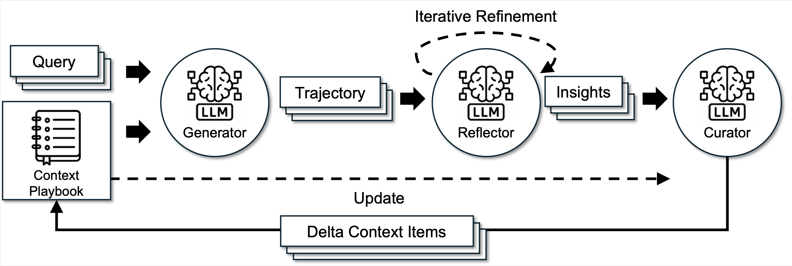
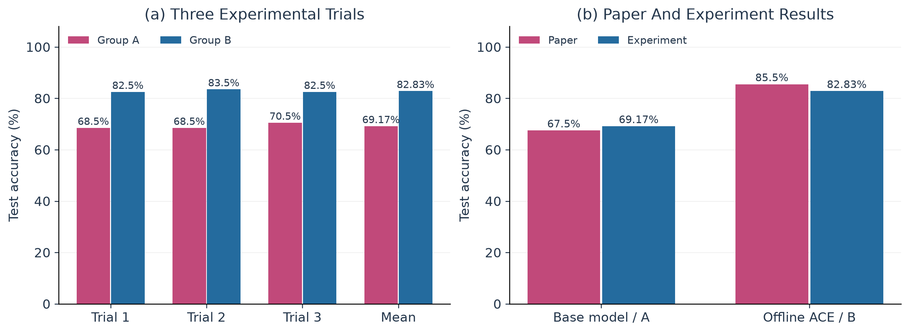
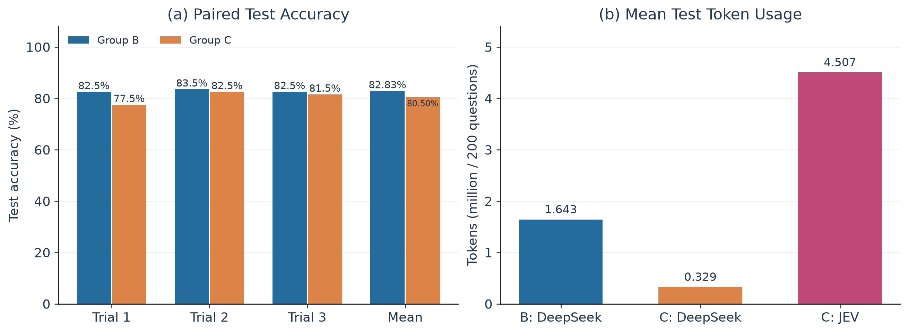
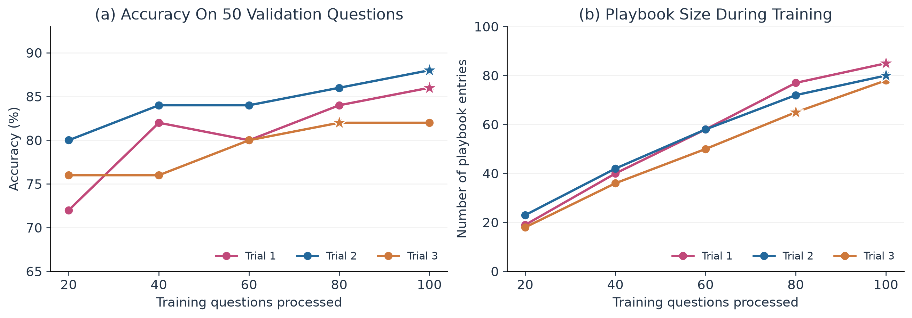
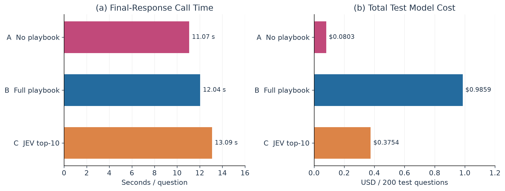

# Report：ACE 在 Formula 金融推理任务上的复现与优化

## 1. 项目介绍

### 1.1 项目原理

本项目旨在复现 Agentic Context Engineering（[ACE](https://github.com/ace-agent/ace)）在 Formula 金融数值推理任务上的离线上下文学习流程，并检验在不更新语言模型权重的条件下，通过将训练过程中积累的经验加入提示词，能否提高金融计算题的回答准确率。

ACE 本质上并不是智能体或者 Harness 平台，而是一个围绕语言模型组织生成、反思和经验整理的框架。它将可重复使用的公式、解题策略和常见错误保存为文本手册，并在后续任务中作为上下文的一部分提供给模型。因此，本文所称的“训练”是生成和更新手册，不涉及梯度计算、参数微调或训练新的神经网络。Formula 金融数值推理任务要求模型理解金融概念、识别数值、选择计算方法并输出结果。本实验不直接向模型提供原始数据中的公式和解释，但模型可以通过经验手册获得相关信息。

ACE 的工作流程如图所示，是一个“问题作答—结果反馈与反思—经验积累”的多步循环。

1. Generator 读取当前训练题和已有手册进行回答，若当前题目回答错误，可以在额外给出反思提示的情况下最多进行三轮重试。
2. Reflector 根据标准答案和作答结果进行反思，输出纠错建议和可复用的经验。
3. Curator 结合反思经验与现有手册，给出最终添加到手册的全新条目。



### 1.2 智能体定义

本实验中的三个角色由同一个模型通过不同提示词实现，并要求以 JSON 格式返回各自的处理结果。

**Generator**

- `reasoning`：说明所采用的解题方法、计算过程和判断依据。
- `bullet_ids`：列出模型认为与当前解题相关的手册条目编号。
- `final_answer`：给出最终答案，由程序提取后与标准答案比较。

**Reflector**

- `reasoning`：给出对当前作答过程的分析。
- `error_identification`：指出具体的概念、计算或策略使用错误。
- `root_cause_analysis`：解释错误背后的原因，而不只描述错误结果。
- `correct_approach`：说明应采用的正确解题方法，供 Generator 重答时参考。
- `key_insight`：总结值得保留的公式、策略或注意事项，供 Curator 整理。
- `bullet_tags`：为相关条目标记 `helpful`、`harmful` 或 `neutral`，每个元素包含 `id` 和 `tag`，由程序更新条目的使用反馈计数。

**Curator**

- `reasoning`：解释为何需要补充这些经验。
- `operations`：返回增量操作列表，每项包含操作类型 `type`、所属章节 `section` 和经验正文 `content`。

## 2. 实验设置

### 2.1 实验环境

- Python：`3.12.14`
- OpenAI Python SDK：`2.21.0`
- Hardware：`Macbook Air M2`
- Model：`siliconflow/deepseek-v3.1-terminus`
- Response：`temperature=0`、`enable_thinking=false`、`max_tokens=4096`

### 2.2 实验数据

实验采用仓库 `eval/data/` 下的 Formula 数据，原文件包含 500 道训练题、300 道验证题和 200 道测试题，覆盖相同的 50 种公式，每条记录包含题目内容与数值标准答案。其中，训练集用于结果反思与手册更新，验证集用于选择最佳手册，测试集用于衡量最终表现。本次实验按公式类别分层抽样，训练和验证抽样分别使用种子 42 和 43，从每种公式中选取两道训练题和一道验证题，形成 100/50/200 的训练、验证、测试规模（测试集全部保留），抽样后按源文件行号排序，每一组的三次实验使用相同的样本与顺序。

### 2.3 实验过程

以 B 组为例，每次实验均从空手册开始，结果分别保存在 `ace/results/B/01/`、`02/` 和 `03/`：

1. **训练**：按固定顺序逐题处理 100 道训练题，批大小为 1，共训练 1 个 epoch；每道错题最多反思和重答 3 轮，每题完成后整理并按需更新手册。逐题答案、正误及反思轮数保存在各次实验的 `train_results.json` 中，模型调用记录保存在 `llm_calls.jsonl` 中。
2. **验证**：在第 20、40、60、80、100 步，使用当时的完整手册回答固定的 50 道验证题。验证记录保存在 `train_results.json` 中，验证准确率最高的手册保存为 `best_playbook.txt`；如果准确率相同，则保留较早的手册。
3. **测试**：完成 100 道训练题后，使用最佳手册回答全部 200 道测试题。逐题预测及正误保存在 `predictions.jsonl` 中，测试准确率、耗时和用量等汇总保存在 `result.json` 中。

### 2.4 实验组别

| 组别 | 类型 | 经验 | 学习过程 | 设计目标 |
|---|---|---|---|---|
| A | no playbook | 无经验条目 | 不学习，直接回答测试题 | 测量统一提示词下模型自身的基础能力 |
| B | full playbook | 验证集选出的完整手册 | 从空手册开始学习，错题最多三轮反思与重答 | 检验经验积累相对 A 的收益 |
| C | partial playbook | 复用 B 组手册，但只选取评分最高的 10 条经验 | 复用 B 的最佳手册，不重新学习 | 检验使用筛选后的经验相对 B 的收益 |

### 2.5 结果指标

| 指标 | 定义 | 公式 |
|---|---|---|
| 准确率 | 预测数值与标准答案一致的比例 | \(a=\frac{1}{N}\sum_{i=1}^{N}\mathbf{1}(\hat y_i=y_i)\) |
| 响应时间 | 每题模型 API 调用耗时之和的平均值 | \(\bar t=\frac{1}{N}\sum_{i=1}^{N}(t_{DS,i}+t_{JEV,i})\) |
| 模型调用成本 | 根据测试阶段 Token 用量来计算的模型调用费用 | \(C_{DS}=0.004(T_{in}+T_{out})/10^3\) CNY<br />\(C_{JEV}=0.042(T_{in})/10^6\) USD |

## 3. 实现结果

### 3.1 论文复现

本次复现旨在检验：通过 ACE 从训练题中积累经验，能否提高模型在 Formula 测试集上的准确率。为此，A 组使用空手册直接作答，B 组使用训练过程中由验证集选出的最佳手册。两组均在相同的 200 道测试题上重复实验三次。

如图所示，A 组的平均准确率为 69.17%，B 组为 82.83%，提高了 13.67 个百分点。三次实验中，B 组均优于 A 组，分别提高 14.0、15.0 和 12.0 个百分点，表明在本实验条件下，经验手册对金融数值推理具有明显的帮助。

在原论文中，Formula 任务的基础模型准确率为 67.5%，使用训练标签的离线 ACE 准确率为 85.5%，提高了 18.0 个百分点。本实验同样观察到了使用经验手册后准确率提高的趋势，但 B 组的平均准确率比论文中的 ACE 结果低 2.67 个百分点。这一差异可能与模型版本和数据规模有关：论文使用 DeepSeek-V3.1，本实验使用 DeepSeek-V3.1-Terminus，且训练集和验证集使用了抽样数据，因此两者的实验条件并不完全相同。



### 3.2 论文改进

B 组在回答每道测试题时都会传入完整手册，但并非所有经验都与当前问题相关。因此，本次改造在 Generator 作答前引入 JEV 相关性筛选，目的是在保留有用经验的同时，减少提供给 DeepSeek 的上下文。C 组复用同编号 B 组实验选出的最佳手册，不重新训练，也不通过测试集调整筛选数量。

具体而言，系统将当前测试题以及候选经验的编号、章节和正文发送给 `jev-1.13.0` 的 Score 接口，要求其判断各条经验与当前题目的相关性，而不提供标准答案。评分标准分为 0 至 3 四个等级，依次表示无关、仅话题相关或泛泛提醒、可用于辅助步骤、直接支持核心公式或关键计算。程序按 score 降序选取前 10 条经验，同分时保留其在原手册中的顺序，再按原顺序将选中的条目提供给 Generator。筛选过程不会修改原手册，JEV 也不直接回答题目。以下为发送给 JEV 的数据示例：

```json
{
  "model": "jev-1.13.0",
  "state": {
    "question": "Calculate the current ratio ...",
    "candidates": [
      {
        "id": "calc-00021",
        "text": "Current ratio = current assets / current liabilities.",
        "section": "## FORMULAS & CALCULATIONS"
      },
      ...
    ]
  },
  "questions": {
    "relevance_0": {
      "type": "score",
      "instructions": "Rate how much candidates[0] supports solving the question using the ordered criteria. Judge relevance and usability only; do not solve the question or verify arithmetic.",
      "criteria": [
        "Unrelated to solving this question.",
        "Only topically related or a generic reminder; provides no usable solving step.",
        "Usable for a supporting step, but does not directly support the core formula or a key calculation.",
        "Directly supports the core formula or a key calculation step for this question."
      ]
    },
	  ...
  }
}
```

如图所示，C 组的平均准确率为 80.50%，相比 B 组的 82.83% 下降了 2.33 个百分点；三次配对实验分别下降 5.0、1.0 和 1.0 个百分点。每次测试的平均 DeepSeek Token 用量从约 164.3 万降至 32.9 万，减少了 79.96%；但与此同时，筛选过程额外消耗约 450.7 万 JEV Token。

按照指定单价统一换算为美元，B 组每次测试的平均模型调用成本约为 $0.9859，C 组的 DeepSeek 和 JEV 成本分别约为 $0.1975 和 $0.1779，合计 $0.3754。由此可见，固定 top-10 筛选虽然在一定程度上降低了准确率，但显著降低了整体模型调用成本。



## 4. 实验结论

### 4.1 总结

从训练过程来看，B 组的验证准确率随着手册积累整体提高，但并非单调上升。例如，B/01 从第 40 步的 82% 降至第 60 步的 80%，随后再次提高；B/03 在第 80 步和第 100 步的准确率均为 82%。由此可见，手册积累总体上有助于提高验证准确率，但更多经验并不一定带来持续提升，使用验证集有助于选择表现较好的手册。



从测试准确率来看，A、B、C 三组的平均准确率分别为 69.17%、82.83% 和 80.50%，其中使用完整手册的 B 组比空手册 A 组提高 13.67 个百分点，使用 JEV 筛选手册的 C 组仍比 A 组高 11.33 个百分点。由此可见，经验手册能够明显提升模型的测试准确率，而经过 JEV 筛选后，模型仍保留了大部分性能增益。


从测试的响应效率来看，A、B、C 三组平均每题调用耗时分别为 11.07、12.04 和 13.09 秒，三次实验中每次测试的平均模型调用总成本分别约为 $0.0803、$0.9859 和 $0.3754。A 组比 B 组每题快约 1 秒，但准确率低 13.67 个百分点；B 组比 C 组每题快约 1 秒，成本却约为 C 组的 2.63 倍。由此可见，C 组在本实验中实现了准确率、响应时间和调用成本之间较好的综合权衡。



### 4.2 不足与展望

1. 本实验规模和复现条件仍有局限：训练集和验证集均经过采样，模型版本、训练轮数和基础提示词也与论文不完全一致。因此，现有结果只能支持当前设置下的趋势比较。后续可以尽可能对齐论文原始设置，进一步检验结果的稳定性。
2. 本次 JEV 改造只测试了固定的 top-10 策略，缺少不同 k 值以及随机选择、关键词检索等对照，无法判断准确率下降究竟主要来自筛选数量还是相关性排序。后续可以在验证集上选择筛选参数，还可以比较不同检索方法，并检查候选经验之间是否存在冲突或缺少关键计算规则，以探索准确率与上下文开销之间更合适的权衡。
